# Places, Please

An iOS app for memorizing lines. Import a script by photographing its pages or uploading a PDF or Word file, then rehearse with an AI scene partner.

- **Run Lines**: your partner reads the other parts aloud, then listens while you say your line. A chime means word perfect, a soft tone means close (a little off), and a buzz means missed; after a miss you hear the correct line. It keeps running with the screen off.
- **Warm Up**: flash cards. You see a cue line and pick your next line from four choices.
- **Listen**: the whole scene read aloud with a different voice for each character. You can leave gaps to say your own lines.

Built with Expo SDK 58 and Expo Router. Data lives in Supabase (Postgres), AI calls go through OpenRouter, and scene-partner voices come from ElevenLabs, both via a Supabase Edge Function.

## Screenshots

Taken in the iOS Simulator (iPhone 17 Pro) with a public-domain scene from *Romeo and Juliet*. Expo Go's floating developer button was painted out.

| Home | Script | Add a script |
|:---:|:---:|:---:|
| 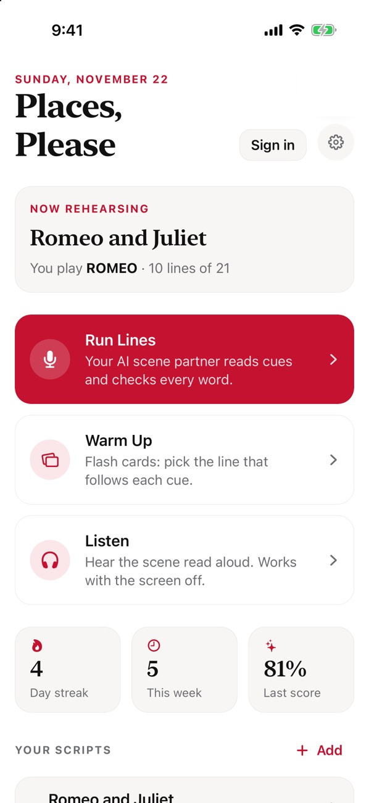 | 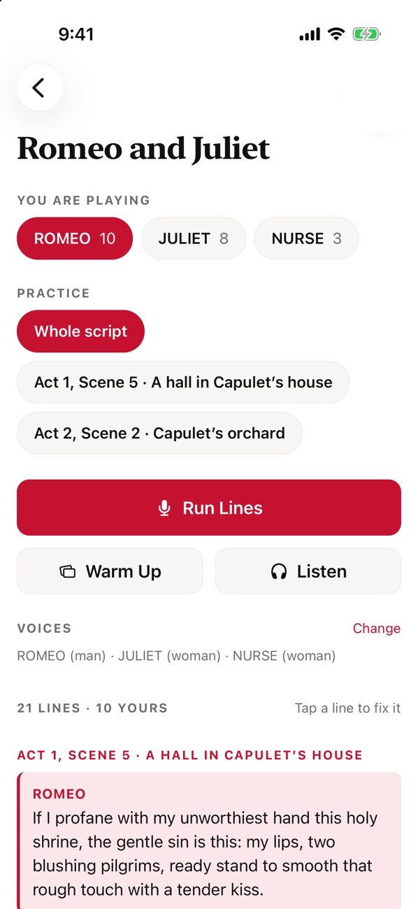 | 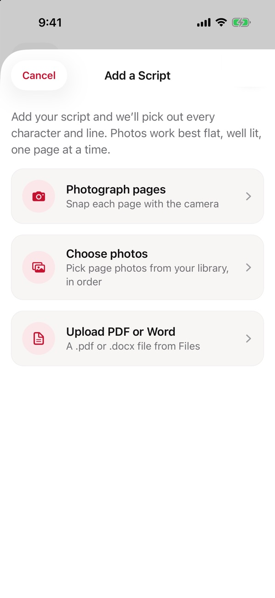 |
| Your current script, the three practice modes, and your progress. | Pick your character and a scene, then start practicing. Tap any line to fix it. | Photograph pages, pick photos, or upload a PDF or Word file. |

| Run Lines | Warm Up | Listen |
|:---:|:---:|:---:|
| 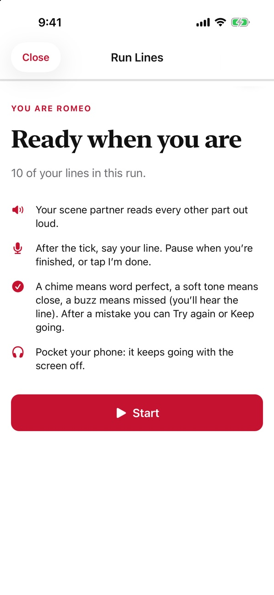 | 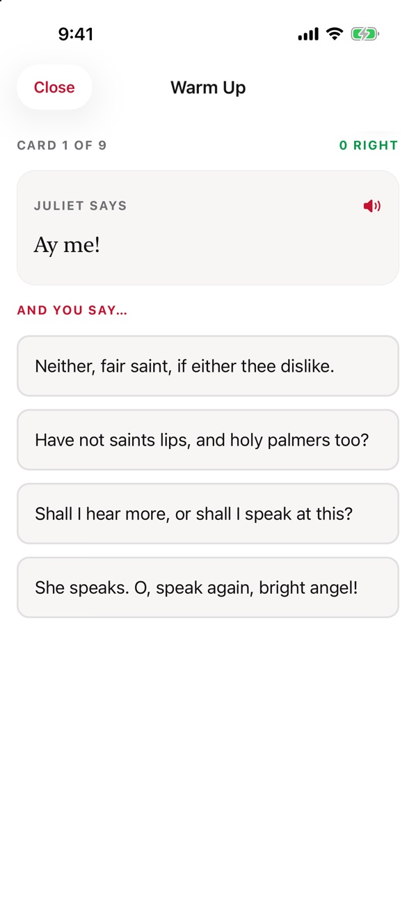 | 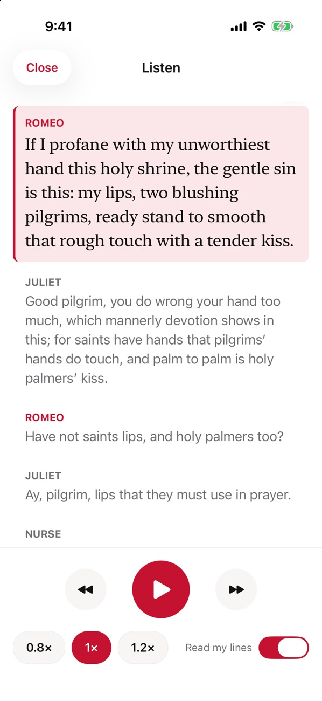 |
| The scene partner reads the cues, listens to your line and checks every word. | Flash cards: pick the line that follows each cue. | The scene read aloud with a voice per character; works with the screen off. |

| Edit a line | Practice history | Settings |
|:---:|:---:|:---:|
| 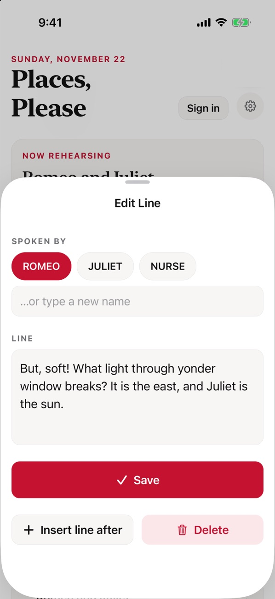 | 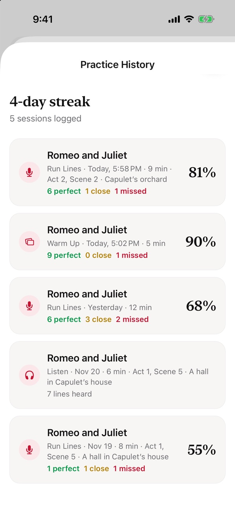 | 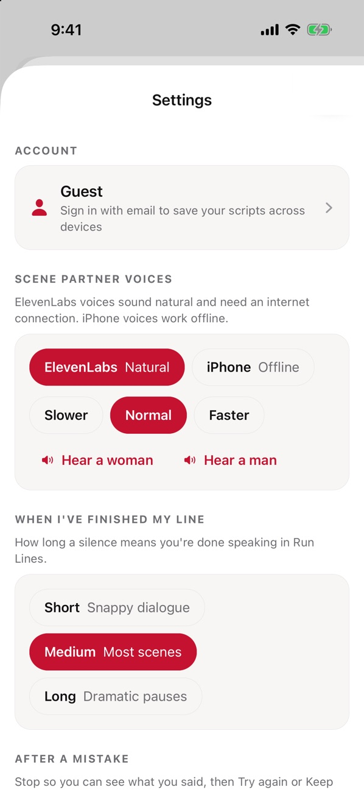 |
| Fix a word the AI misread, change the speaker, add or delete a line. | Every session with its score, and your streak. | Voices, speed, pause length, what happens after a mistake, and a sound check. |

| Account | Dark mode | Dark mode |
|:---:|:---:|:---:|
| 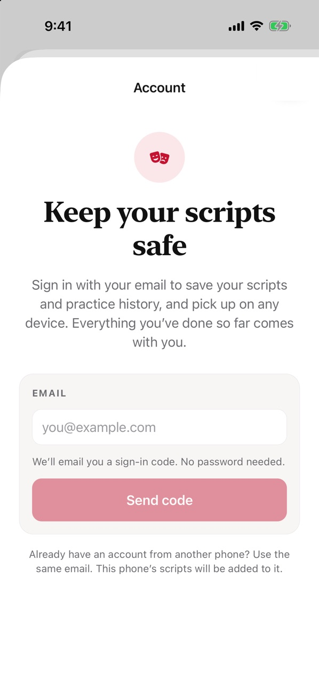 | 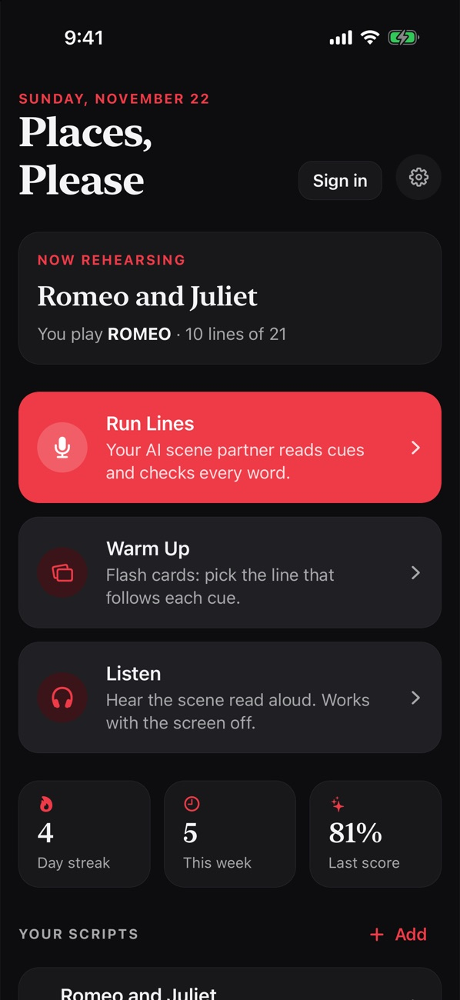 | 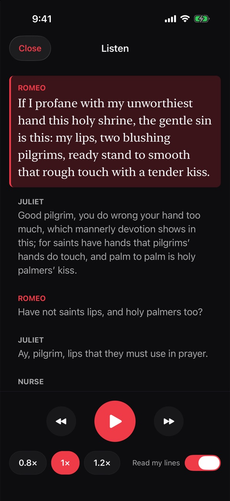 |
| Sign in with an emailed code, no password. Guest scripts come along. | Every screen follows the phone's light or dark setting. | |

## Tech stack

| Layer | What | Why |
|---|---|---|
| App framework | **Expo SDK 58**, React Native 0.88, React 19 with the React Compiler, TypeScript | One codebase, runs in Expo Go during development, builds for iOS with EAS. |
| Navigation | **Expo Router** (file-based routes in `src/app/`, native stack, sheets and full-screen modals, typed routes) | Screens are files; deep links work for free. |
| Audio | `expo-audio` (recording at 16 kHz WAV with live metering, playback, background audio session), `expo-speech` (iPhone voices), `expo-haptics` | Scene partner, line recording, chime/tone/buzz, screen-off practice. |
| Voices | **ElevenLabs** text-to-speech (`eleven_flash_v2_5`), with the iPhone's built-in voices as the offline fallback | Natural male and female voices per character. |
| AI | **OpenRouter** (Google Gemini Flash models) for reading script pages, guessing character genders and transcribing your lines | One API key, several models with automatic fallbacks, cost reported per call. |
| Backend | **Supabase**: Postgres with row level security, Auth (anonymous guests and emailed sign-in codes), and a Deno Edge Function (`places-ai`) | Keeps API keys off the phone, logs every paid call with its cost, enforces daily spending caps. |
| Files | `expo-image-picker` and `expo-image-manipulator` (camera and photos, resized on the phone), `expo-document-picker` (PDF and Word); `unpdf` and `fflate` on the server | Script import. |
| On-device storage | AsyncStorage (scripts, settings), `expo-secure-store` / iOS Keychain (sign-in session), `expo-file-system` (cached voice audio) | Opens instantly and works offline; Supabase stays the source of truth. |
| UI | Custom components in `src/components/ui/`, SF Symbols via `expo-symbols`, Reanimated for the voice meter, CMU red and a serif display font | Clean typography; light and dark mode. |
| Quality | Node's built-in test runner (scoring, script model, Warm Up, settings validation), `tsc`, ESLint (`expo lint`) | |

## User flow

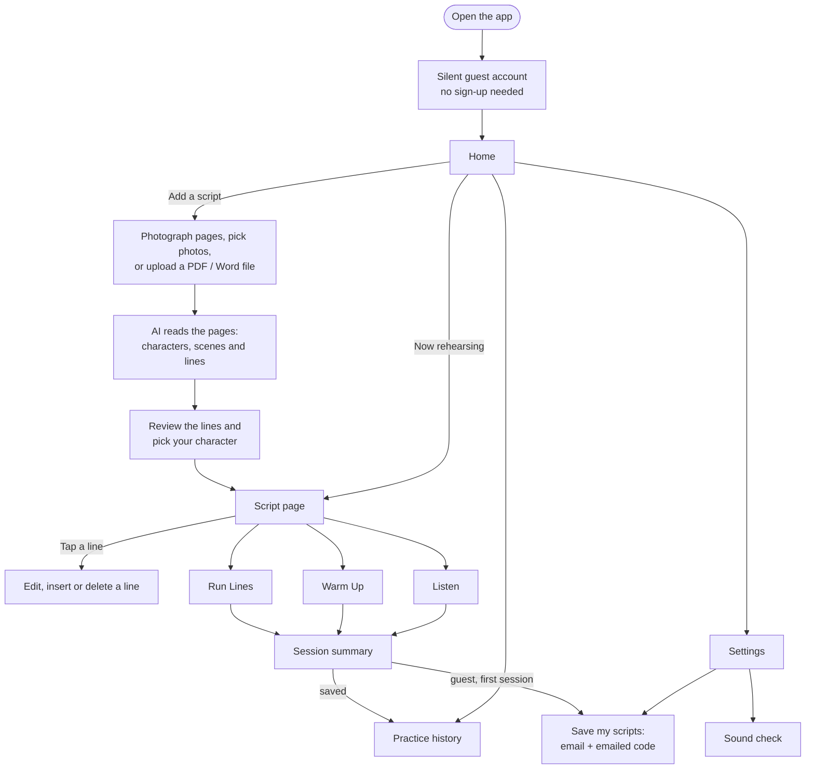

1. **Start.** The first launch quietly creates a guest account, so you can try everything without signing up.
2. **Add a script.** Photograph pages (or pick photos, or upload a PDF or Word file). The AI finds every character, scene and line, and guesses each character's gender to pick a voice. You check the result and choose who you play.
3. **Practice.** From the script page, choose the whole script or one scene, then:
   - **Run Lines.** For each line, the partner reads the cue, a tick means "your turn", you speak, and a pause (or **I'm done**) ends your line.
     - The recording is transcribed and compared word by word on the phone.
     - **Perfect** chimes, **close** plays a soft tone, and **missed** buzzes and reads you the correct line.
     - After a mistake, the run stops so you can **Try again** or **Keep going**.
   - **Warm Up.** For each cue, pick your reply from four choices.
   - **Listen.** The scene plays like a radio play, with a voice per character. **Read my lines** off leaves a gap for you to speak.
4. **Track progress.** Each session is saved with its score. Home shows your streak, sessions this week and last score, and **History** lists every session.
5. **Keep it.** After your first session, guests are offered **Save my scripts**: enter your email and the code you're sent. Your guest scripts and history move into that account.

What happens during one line of **Run Lines**:

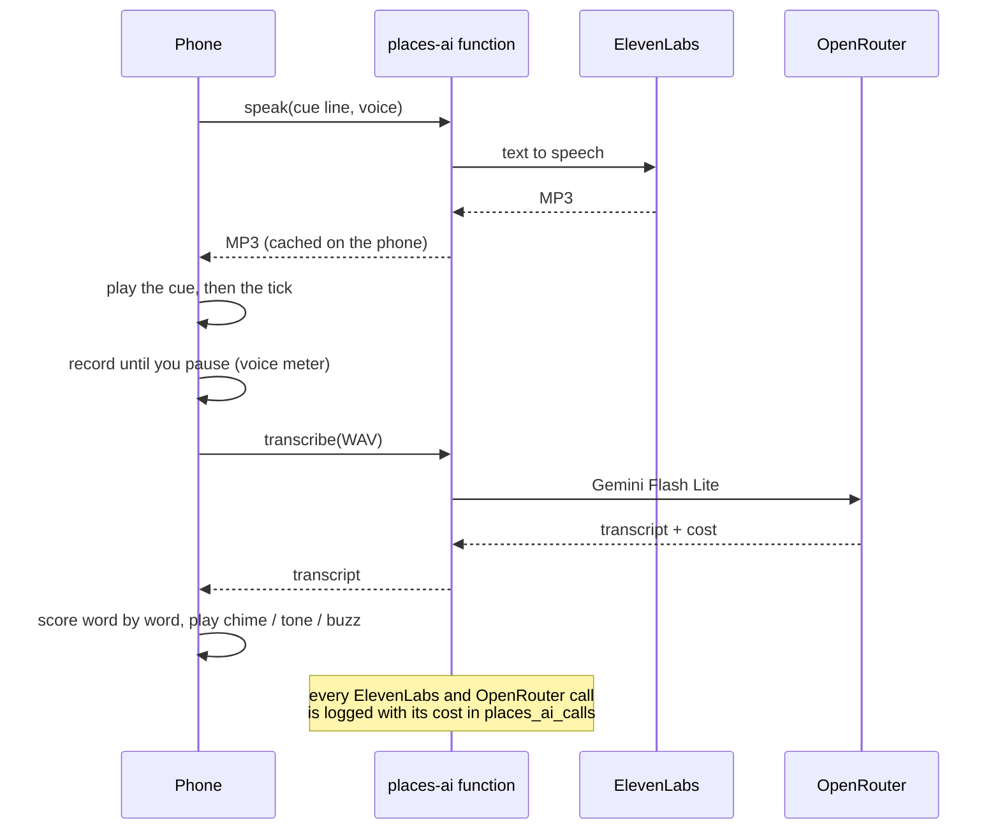

## Data model

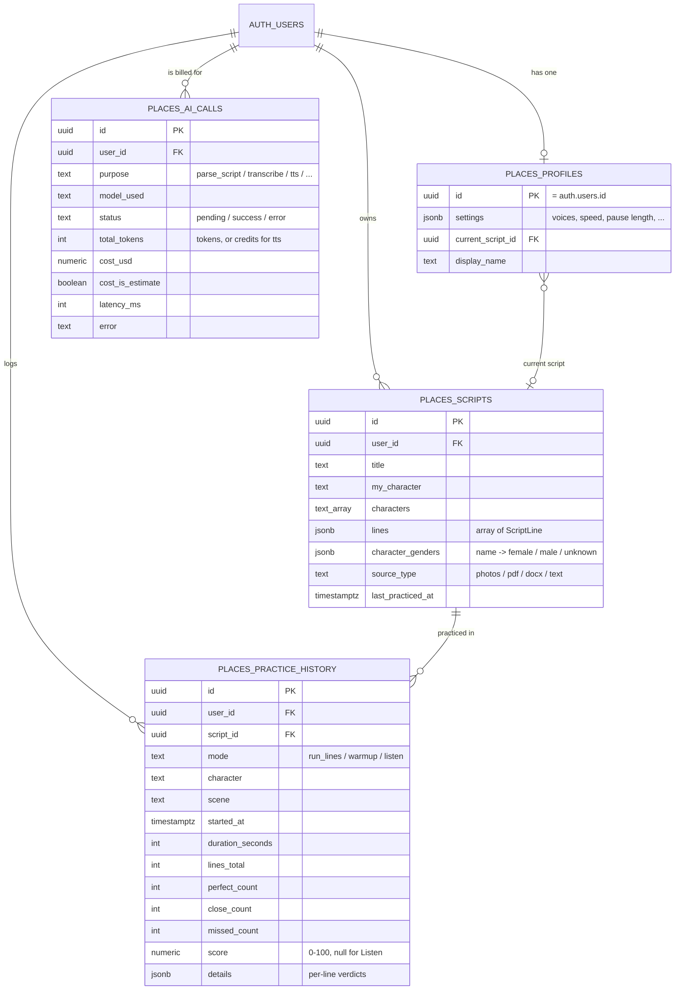

All four tables live in the shared Supabase project, prefixed `places_`, with row level security so each person can only see their own rows. The migrations are in `supabase/migrations/`.

| Table | One row per | Written by | Notes |
|---|---|---|---|
| `places_profiles` | user | the app | Settings (as JSON) and which script is "Now rehearsing". Created by the app on first use (there's no trigger on `auth.users`, because the project is shared). |
| `places_scripts` | imported script | the app | The whole script lives in one row: `lines` is a JSON array, so a script loads, saves and syncs in one request. |
| `places_practice_history` | practice session | the app | Scores and counts for History and the Home stats. `details` keeps each line's verdict and accuracy (the transcript is not stored). |
| `places_ai_calls` | paid AI or voice call | the `places-ai` function only | The cost ledger (see [AI cost logging](#ai-cost-logging)). Users can read their own rows; only the function can write. |

Inside a script, each entry of `lines` is a `ScriptLine`:

```json
{ "id": "l_mbx2k9_4f1a2c", "character": "JULIET", "text": "O Romeo, Romeo! Wherefore art thou Romeo?", "scene": "Act 2, Scene 2" }
```

The app's TypeScript types for all of this are in `src/lib/types.ts` (`Script`, `ScriptLine`, `PracticeSession`, `LineAttempt`, `Settings`).

### On the device

The app keeps a copy on the phone so it opens instantly and survives closing the app, even with no connection:

- **AsyncStorage** (`src/lib/local-store.ts`, `@react-native-async-storage/async-storage`): your scripts, settings and current script, saved after every change under a per-user key (`places-please:v1:<user id>`). On launch, Home shows this copy right away, then refreshes from Supabase. (On web, AsyncStorage uses the browser's localStorage.)
- **Keychain** (`src/lib/secure-storage.ts`, `expo-secure-store`): the sign-in session, so you stay signed in. It's split into chunks because a session can be larger than one Keychain item.
- **File cache** (`expo-file-system`): each scene-partner line's audio, so a line is only paid for once and plays instantly next time.
- **Never stored:** your line recordings. They're deleted right after they're checked.

Supabase stays the source of truth and syncs across devices.

## Architecture

```
iPhone app (Expo)                       Supabase
─────────────────                       ────────────────────────────────────────────
Guest sign-in → email code (optional) ─→ Auth
scripts / practice_history / profiles  → Postgres (row level security: own rows only)
pages, audio, lines to speak ─────────→ Edge Function `places-ai` ──→ OpenRouter, ElevenLabs
                                          • holds the OpenRouter and ElevenLabs keys (never in the app)
                                          • logs every call + cost to `places_ai_calls`
                                          • daily spend caps
```

- **Script import**: photos are resized on the device and sent in batches of 3 pages. PDF and Word text is extracted on the server and parsed in chunks. A scanned PDF is sent to the model whole.
- **Line checking**: your recording (16 kHz WAV) is transcribed word for word by the AI. Scoring happens on the device with a word-level edit distance. Perfect means every word matches; close means at least 75% match. Recordings are deleted from the phone right after checking and are never stored.
- **Voices**: ElevenLabs voices, with a woman's or man's voice per character. The AI guesses genders when it reads a script; change them under **Voices** on the script page. The `places-ai` function holds the ElevenLabs key and logs each line's cost. The app caches each line so it's only paid for once, and fetches the next lines ahead of time. If ElevenLabs fails (no key, no connection, out of credits), the line is spoken with the phone's built-in voice instead. **Settings › Scene partner voices** switches between ElevenLabs and iPhone voices, and **Settings › Sound check** tests each kind of sound.
- **Screen-off practice**: background audio mode, plus a silent keep-alive loop so iOS doesn't suspend the app between lines.

## Project structure

```
src/
├── app/                    Screens (Expo Router: every file is a route)
│   ├── _layout.tsx         Navigation stack, error boundary, sign-in gate
│   ├── index.tsx           Home
│   ├── scripts/new.tsx     Add a script (photos / PDF / Word → AI → review)
│   ├── scripts/[id]/       Script page, run.tsx, warmup.tsx, listen.tsx, line/[lineId].tsx (edit a line)
│   ├── history.tsx, settings.tsx, account.tsx
├── components/             UI pieces, grouped by the screen that uses them
│   ├── ui/                 Shared building blocks: Text, Button, Card, Chip, Icon, loading / error views
│   ├── home/  script/  import/  run-lines/  warmup/  listen/  line-editor/  settings/  account/  history/
│   └── line-diff.tsx, session-summary.tsx, voice-meter.tsx, ...   shared across screens
├── hooks/                  Screen logic kept out of the JSX: use-line-runner, use-script-import,
│                           use-listen-player, use-warmup-round, use-session-saver, use-theme, ...
├── providers/              AuthProvider (guest / email session), DataProvider (scripts, settings, sync)
├── lib/                    Plain TypeScript, no React
│   ├── api.ts              Supabase reads and writes
│   ├── ai.ts               Calls to the places-ai function
│   ├── scoring.ts          Word-by-word line scoring (perfect / close / missed)
│   ├── script-import.ts    Import pipeline; script-model.ts merges parsed pages into lines
│   ├── rehearsal/          LineRunner (Run Lines), ListenPlayer, Warm Up question builder
│   ├── audio/              Voices (tts.ts), recording and pause detection, sound effects,
│   │                       audio session (screen-off), sound check
│   ├── local-store.ts, secure-storage.ts   On-device storage
│   └── types.ts            Script, ScriptLine, PracticeSession, Settings, ...
└── constants/theme.ts      Colors (CMU red, light and dark), spacing, type scale
supabase/
├── migrations/             The four places_ tables, row level security, the cost-ledger function
└── functions/places-ai/    The edge function: script reading, transcription, voices, cost logging
test/                       Unit tests (Node's test runner)
docs/screenshots/           The screenshots above
```

The code follows a few simple rules: screens in `src/app/` stay short and mostly lay out components; anything stateful lives in a hook in `src/hooks/`; anything that doesn't need React (scoring, parsing, audio, API calls) lives in `src/lib/` where it can be unit-tested.

## Setup

### 1. Supabase project (shared with Ignatius at Home)

This app shares the `ben@collier.phd` Supabase project with Ignatius at Home. To stay out of the other apps' way:

- Every table, index, function and trigger is prefixed `places_` (`places_scripts`, `places_profiles`, `places_practice_history`, `places_ai_calls`).
- There is **no trigger on `auth.users`**. The app creates its own `places_profiles` row when it first needs one.
- The edge function is named `places-ai`.
- Sign-ins are shared: the same email signs in to both apps. **Delete my data** removes only this app's rows, and deletes the login itself only for a guest.

Apply the schema once: paste each file in `supabase/migrations/` (in order) into the dashboard's **SQL Editor** and run it. (Avoid `supabase db push` here; the shared project's migration history belongs to the other apps.)

### 2. Sign-in (email, same model as Ignatius at Home)

Nobody has to sign in to start: the app creates a silent guest account on first launch. Guests are offered **Save my scripts** after their first finished session and in **Settings › Account**: enter your email, then the emailed code. That signs you in (to a new account, or the one you already use for Ignatius at Home) and copies this phone's guest scripts and history into it; the leftover guest copy is then deleted.

The shared project is already set up for this: anonymous sign-ins are on, and the **Magic link or OTP** and **Confirm sign up** templates already include the code (`{{ .Token }}`). The emails say "Ignatius at Home" because templates are per project; don't change them, Ignatius uses them. (The app doesn't use the link-only **Change email address** template.) The files in `supabase/templates/` are only for the local test stack (`npx supabase start`).

### 3. AI edge function

Set the secrets in the dashboard (**Edge Functions › Secrets**) or with the CLI, then deploy:

```bash
npx supabase login
npx supabase secrets set --project-ref <project-ref> OPENROUTER_API_KEY=sk-or-... ALLOWED_EMAILS=you@example.com
npx supabase functions deploy places-ai --project-ref <project-ref>
```

**ElevenLabs voices:** add an `ELEVENLABS_API_KEY` secret (ElevenLabs › Developers › API keys; it only needs Text to Speech access). Optional: `ELEVENLABS_MODEL` (default `eleven_flash_v2_5`, half a credit per character) and `ELEVENLABS_USD_PER_CREDIT` (default 0.0002; set it to your plan's price so the cost log is right). Voice calls are logged in `places_ai_calls` with purpose `tts`. They count toward the daily AI budget.

`ALLOWED_EMAILS` works like Ignatius at Home's: when it's set, only those signed-in emails can use the AI (script reading and line checking). Guests and other accounts get a "sign in with your email" message. Leave it unset to allow everyone, with only the daily spending caps.

Optional secrets:

| Secret | Default | Purpose |
|---|---|---|
| `OPENROUTER_PARSE_MODELS` | `google/gemini-3.8-flash,google/gemini-2.5-flash` | Script reading (first = preferred, the rest are fallbacks) |
| `OPENROUTER_TRANSCRIBE_MODELS` | `google/gemini-3.5-flash-lite,google/gemini-2.5-flash` | Line transcription |
| `DAILY_USER_LIMIT_USD` | `3` | Per-user daily AI budget |
| `DAILY_TOTAL_LIMIT_USD` | `10` | Total daily AI budget for this app |

### 4. App environment

```bash
cp .env.example .env.local
# fill in EXPO_PUBLIC_SUPABASE_URL and EXPO_PUBLIC_SUPABASE_ANON_KEY (Project Settings › API)
npm install
npx expo start
```

The anon (publishable) key is meant to ship in apps; row level security protects the data. Never put the OpenRouter key or the `service_role` key in `.env.local`.

### Running on a phone

Expo Go works for trying things out. Screen-off practice needs background audio, which only works in a development or production build:

```bash
npx expo run:ios            # local dev build (needs Xcode)
# or
npx eas-cli@latest build --profile development --platform ios
```

## AI cost logging

Every paid AI call goes through a ledger in `public.places_ai_calls`:

1. **Before sending**, `places_begin_ai_call` (a Postgres function) checks the daily spend caps and inserts a row with `status = 'pending'` and an estimated cost, in one transaction under an advisory lock, so simultaneous requests can't race past the caps. If that row can't be written, the call is not sent.
2. **After the reply**, the row is completed: status, model used, tokens, latency, and OpenRouter's reported `usage.cost` (`cost_is_estimate = false`).
3. If the function stops mid-call, the row stays `pending` with its estimate, so nothing that was sent goes unrecorded. Timeouts keep the estimate too, because the provider may still bill them. ElevenLabs bills in credits whose price depends on the plan, so voice costs are credits used × `ELEVENLABS_USD_PER_CREDIT`, flagged with `cost_is_estimate = true`.

Only the edge function can write this table; users can read their own rows, and **Settings › AI usage** shows the 30-day total.

```sql
-- spend by day and purpose
select date_trunc('day', created_at) as day, purpose, count(*), sum(cost_usd)
from places_ai_calls group by 1, 2 order by 1 desc;
```

## Development

```bash
npm test              # unit tests (Node's test runner): scoring, script model, Warm Up, settings validation
npm run typecheck     # app + tests
npx expo lint         # lint
npx expo-doctor       # dependency check
node scripts/generate-sounds.mjs   # regenerate the sound effects in assets/sounds
```

Local Supabase (needs Docker): `npx supabase start` applies the migration, then put the printed API URL and anon key in `.env.local`.

## Adding exercises

Practice modes share `src/lib/types.ts` (`PracticeMode`), `src/lib/api.ts` (`savePracticeSession`) and the audio helpers in `src/lib/audio/`. To add a new exercise:

1. Add a mode value in `PracticeMode` and in the `practice_history.mode` check constraint (in a new migration).
2. Put the exercise logic in `src/lib/rehearsal/` and the screen in `src/app/scripts/[id]/`.
3. Register the screen in `src/app/_layout.tsx`, add a tile on the home screen (`src/components/home/practice-modes.tsx`) and a button on the script page (`src/components/script/practice-buttons.tsx`).
